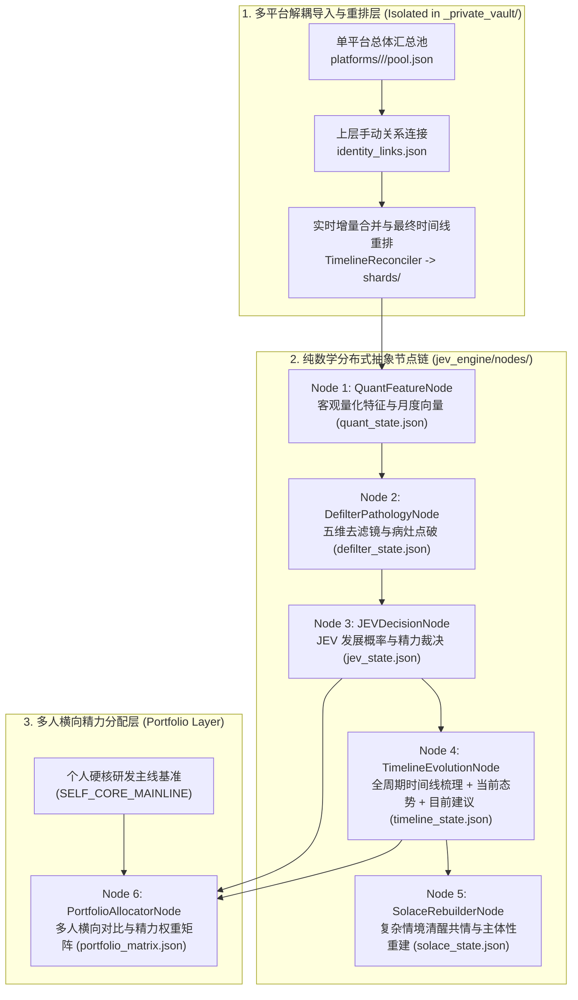

# `she-dont-love-me` (她其实没那么喜欢你)

> **De-filter the Illusions. Reconstruct the Timeline. Quantify True Expected Value.**  
> 一个**零个人信息、零聊天记录文本、隐私物理隔离**的开源多平台关系期望值（**JEV, Joint Expected Value**）评估、全周期时间线梳理与分布式 Agent 辅助决策框架。

---

## 🎯 一、 核心价值：为什么叫 `she-dont-love-me`？

绝大多数聊天分析工具都在给你制造“双向奔赴”的幻觉——它们把**线上秒回率高、消息条数多、深夜频繁闲聊**直接等同于“她喜欢你”。但在现实中，这些表象往往只是广谱社交者的日常消遣，甚至是单向失血的鱼塘陷阱。

本项目通过**导入与分析彻底解耦**的纯数学分布式状态节点，直击四大核心痛点：
1. **明确回答「建不建议继续发展」与「是否继续投入精力」**：在报告最顶端直接给出毫不含糊的终局裁决（`❌ 坚决不建议发展` / `⚠️ 暂不建议单向发展` / `✅ 建议稳步发展`），杜绝模棱两可的鸡汤；
2. **全周期时间线梳理与阶段演进（Timeline Evolution）**：基于月度/阶段数学向量，自动还原关系从「初始破冰 $\rightarrow$ 升温/维持 $\rightarrow$ 断联冰封低谷 $\rightarrow$ 间歇性强化反弹 $\rightarrow$ 当前核心窗口」的完整轨迹；
3. **着重聚焦「当前态势」与「目前分步建议（24h / 7d / 30d）」**：重点剖析最近一个时间窗口的投入失衡度与真实底牌，并给出针对**当下 24 小时、未来 7 天、未来 30 天**的具体可执行动作；
4. **多平台分布式汇总、手动关系绑定与全局重排 + 多人投资组合（Portfolio ROI）分配**：支持跨平台（WeChat / QQ / Telegram 等）增量去重与全局时间线重排，并横向对比多个候选节点与个人硬核研发主线的回报率。

---

## 🛡️ 二、 零个人信息与零聊天记录设计 (Strict Zero-PII & Zero-Chat-Text)

本项目在物理架构上实行最严格的**「开源抽象计算层」与「私有数据隔离层」双轨分离**：

- **零个人信息、零聊天记录**：本仓库所有代码、文档与 `examples/` 目录中**不含任何真实备注、昵称、微信号、学校/单位名称或任何真实对话文本**。
- **纯数学抽象状态节点 (`examples/distributed_nodes/`)**：示例库仅存放纯数学特征向量与布尔信号 JSON（`Archetype_A` 广谱内耗型、`Archetype_B` 双向同频型、`Archetype_C` 礼貌观察型），无需创建任何聊天记录文本即可完整推演时间线与 JEV 裁决。
- **私有数据强制隔离 (`_private_vault/`)**：本地真实聊天记录、多平台汇总池、数据库与密钥全部收拢在独立的 `_private_vault/` 文件夹下，已在 `.gitignore` 中永久屏蔽，**绝不推送至 GitHub**。

---

## 🔄 三、 系统总体架构：多平台重排 + 6 大分布式抽象节点



### 核心模块说明
1. **`multi_platform_sync.py`（多平台三层导入与全局重排）**：
   - **第一层（单平台总体汇总）**：按 `platforms/<platform>/<account_id>/pool.json` 维护单平台历史与实时增量记录，基于 `msg_uid` 哈希幂等去重并推进水位线 `watermark_ts`。
   - **第二层（手动上层关系连接）**：通过 `identity_links.json` 由用户显式绑定同一人在不同平台的账号。
   - **第三层（最终时间线重排）**：以 `(timestamp, platform, msg_uid)` 执行多路归并排序（Multi-way Merge-Sort），消除跨平台乱序并识别会话内跨平台切换。
2. **`timeline_node.py`（全周期时间线梳理、当前聚焦与目前建议）**：
   - 自动识别各月度/阶段属性（`INITIAL_ICEBREAK` 破冰期、`RECIPROCAL_WARMUP` 双向升温期、`COOLING_OR_BREAK` 断联冰封期、`INTERMITTENT_REBOUND` 间歇性强化反弹期、`HIGH_HEAT_ASYMMETRY` 高热单向透支期、`CURRENT_WINDOW` 当前核心窗口）。
   - **着重剖析当前窗口**：对比当前周期与上一周期的边际变化、当前字数投入比与主动破冰率，点破当下真实博弈处境，并输出 **当下 24 小时 / 未来 7 天 / 未来 30 天** 的分步行动建议。
3. **`defilter_node.py` & `jev_node.py`（五维去滤镜与 JEV 期望值裁决）**：
   - 点破五大典型内耗病灶（广谱社交热情错觉、公开场合防线切割、买方货架心态与间歇性强化、双面人设与合群托词、单向失血与陪伴诉求闪避）。
   - 计算 $\text{Net JEV} = (P_{\text{develop}} \times V_{\text{return}}) - C_{\text{burn}}$，输出明确的发展建议与精力投入裁决。

---

## 📊 四、 合成原型评估示例预览（零聊天文本推演）

| 评估节点 / 原型 | 表层热度 | 去滤镜系数 ($\alpha$) | 感情发展可能性 $P(\text{Develop})$ | 净期望值 (Net JEV) | **建不建议继续发展** | **当前阶段定性 & 目前核心建议** | **推荐精力权重** |
| :--- | :--- | :--- | :--- | :--- | :--- | :--- | :--- |
| **`SELF_MAINLINE`<br>*(个人硬核研发主线)* ** | `90.0` | `1.00` | **95.0%** | **+81.2** | 🚀 **100% 建议深耕** | 确定性正反馈基石，长期复利最高 | **60.0%** |
| **`Archetype_B`<br>*(双向同频高回报型)* ** | `81.0` | `1.05` | **92.8%** | **+82.8** | ✅ **建议稳步发展** | `CURRENT_WINDOW` 双向高频共振（字数比 `1.04:1`）；建议 7 天内兑现一对一线下约会 | **32.8%** |
| **`Archetype_C`<br>*(礼貌疏离观察型)* ** | `37.1` | `1.05` | **54.5%** | **+18.3** | ⚠️ **暂不建议单向发展** | `CURRENT_WINDOW` 低频安全区（字数比 `1.7:1`）；建议回收需求感，降频观察对方是否主动破冰 | **7.2%** |
| **`Archetype_A`<br>*(高秒回广谱内耗型)* ** | `88.6` | `0.05` | **3.3%** | **-99.8** | ❌ **坚决不建议发展** | 经历 8 月断联与 9-10 月反弹后，当前（11 月）字数比恶化至 `1.9:1`、我方破冰占 `85%`，触发全部 5 项病灶；**24h 内立即停止主动破冰，彻底止损封存** | **0.0%** |

> 📄 完整生成报告可查看：
> - 单人反面原型报告：[`examples/distributed_nodes/Archetype_A_BroadSiren/reports/jev_single_report.md`](./examples/distributed_nodes/Archetype_A_BroadSiren/reports/jev_single_report.md)
> - 单人正向原型报告：[`examples/distributed_nodes/Archetype_B_ReciprocalPartner/reports/jev_single_report.md`](./examples/distributed_nodes/Archetype_B_ReciprocalPartner/reports/jev_single_report.md)
> - 多人精力分配矩阵：[`examples/portfolio_output/portfolio_allocation_report.md`](./examples/portfolio_output/portfolio_allocation_report.md)

---

## 💻 五、 快速运行命令

```bash
# 1. 运行单人去滤镜 JEV 评估、全周期时间线梳理与当前建议生成
python3 jev_cli.py analyze \
  --nodes-root examples/distributed_nodes \
  --node Archetype_A_BroadSiren \
  --mainline "核心系统架构与硬核技术研发"

# 2. 运行多人横向对比与精力投资组合分配
python3 jev_cli.py portfolio \
  --nodes-root examples/distributed_nodes \
  --output examples/portfolio_output \
  --mainline "核心系统架构与硬核技术研发"
```
