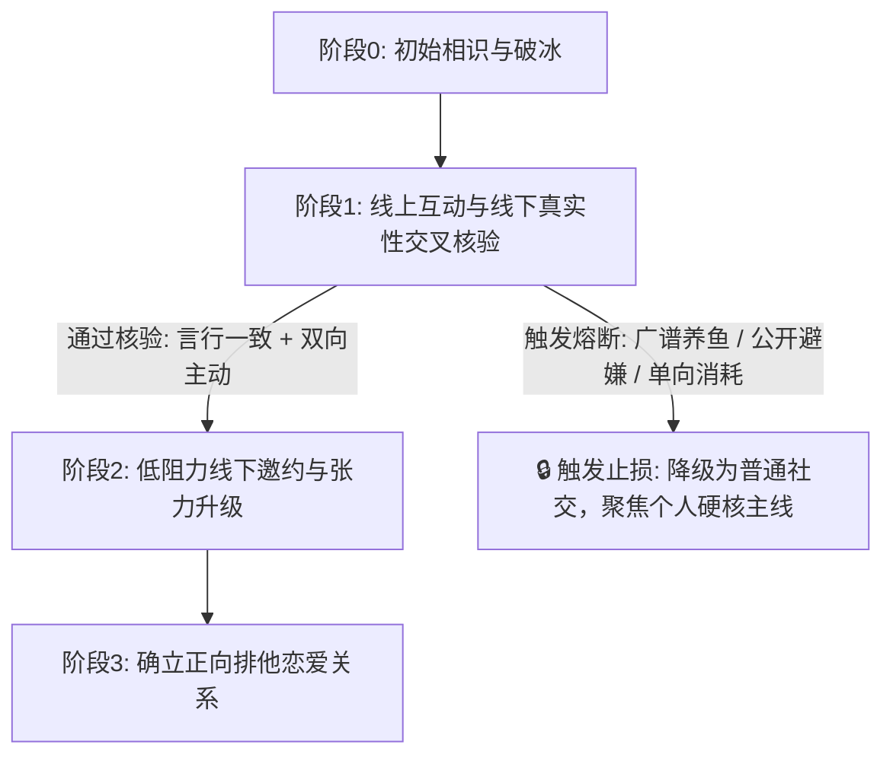

# 《{{CONTACT_NAME}} · 情感诊断与推进路线图》 (Master Roadmap)

> **更新时间**：{{CREATED_AT}}  
> **诊断对象**：{{CONTACT_NAME}}  
> **当前阶段**：待定（破冰期 / 友谊观察期 / 暧昧升温期 / 线下推进期 / 已止损封存）

---

## 模块 1：客观量化与线下交叉体检
- *（运行 `python scripts/quant_slicer.py --contact "{{CONTACT_NAME}}"` 后先查看同目录 `quant_summary.md`，再结合线下交互事实填写）*

## 模块 2：对方心理防御与核心诉求解码
- **核心特质**：
- **潜在风险点**：

## 模块 3：阶段性行动指南
- **线上节奏控制**：
- **线下邀约/验证方案**：
